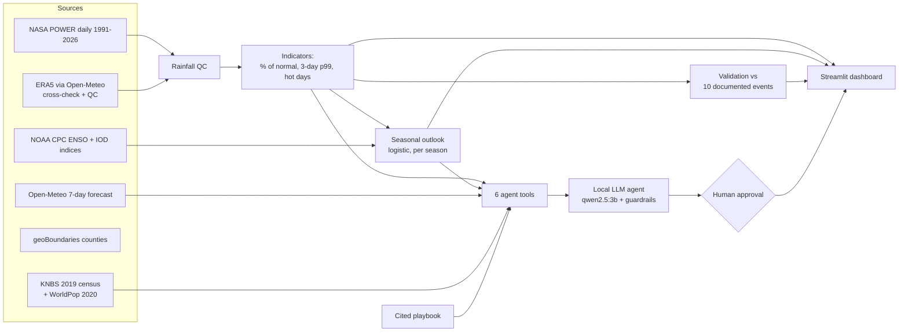

# Ukame Watch

**Drought, heavy-rain and heat early-warning support for eight arid counties of northern Kenya.**
*Ukame* is Swahili for drought.

Zetech Alumni × Student Hackathon 2026 · ML & Data Science track · **Challenge 1: Climate Sentinel**

| | |
|---|---|
| **Live site** | https://patrickwangai.github.io/ukame-watch/ (dashboard only: https://patrickwangai.github.io/ukame-watch/dashboard.html, first load 1–2 minutes) |
| **Demo video** (2 min 57 s, captioned) | https://patrickwangai.github.io/ukame-watch/docs/ukame-watch-demo.mp4 |
| **Submission report** (every deliverable, linked) | [SUBMISSION.md](SUBMISSION.md) |
| **Run it yourself** | [Quick start](#quick-start) |

> **Planning-support tool only — not an official warning system.** Kenya Meteorological Department (KMD) warnings
> and National Drought Management Authority (NDMA) drought bulletins always take priority. Advisories are drafts
> until a named person approves them.

---

## 1. Project overview

Ukame Watch turns 35 years of free, public climate data into plain-language early warnings for the county
disaster managers of **Turkana, Marsabit, Wajir, Mandera, Garissa, Isiolo, Samburu and Kitui**: eight arid
counties home to **5.6 million people** (KNBS 2019 census).

It answers the four questions a county officer asks before a season fails:

| Question | How Ukame Watch answers it |
|---|---|
| **Is this season unusual?** | 3-month rainfall as % of the 1991–2020 normal, and a drought level (Normal, Alert, Alarm) for every county |
| **What is likely next?** | A seasonal outlook (chance the next 3 months fall in the driest third) and a live 7-day heavy-rain and heat watch |
| **Who is exposed?** | Census population per county, an interactive hazard map, and the trend in hot days since 1991 |
| **What should we prepare?** | A cited action playbook, and a local AI assistant that drafts an advisory a named person must approve |

The project has three parts:

- **An analysis pipeline.** One command downloads the data, checks its quality, computes the indicators,
  validates them against documented disasters and trains the forecast.
- **A dashboard.** It runs online in any browser, or offline on a laptop.
- **An AI assistant.** Qwen 2.5 3B runs locally. It can only use six data tools, and code checks every
  number it writes.

Secondary users include county agriculture and livestock officers, and humanitarian partners planning water,
cash and nutrition support.

### Using the dashboard

The top of the page is the situation board:

- **County cards.** For each of the 8 counties:
  - rainfall for the last 3 months as % of normal
  - its drought level
  - its last 8 rainy seasons
  - its population
  - the seasonal outlook
  - the 7-day watch.
- **Hazard map.** It has three layers: rainfall vs normal, population density and hot days.
- **County in focus.** This selector sets which county the tabs below show.

Below the map, seven tabs give the detail:

| Tab | What it shows |
|---|---|
| **Season history** | Every rainy season since 1991 for the chosen county, as % of its 1991–2020 normal. Failed seasons are red, and documented disasters are labelled |
| **Seasonal outlook** | The chance that the next 3 months fall in the driest third, compared with the usual one-in-three. It also shows whether the model beat the climatology and persistence baselines on the test years 2017–2026 |
| **7-day watch** | The live Open-Meteo forecast for the next 7 days, against the county's own extremes: 3-day rain above its 99th percentile, and maximum temperature above its 95th percentile |
| **Heat stress** | Hot days per year since 1991, with the trend test (Mann-Kendall and Sen's slope) and the results for all counties |
| **Track record** | Whether the indicators caught the 10 documented disasters, and whether the worst periods in the data match them. It also has the 8-county rainfall for every rainy season and the cross-check against ERA5 |
| **Draft an advisory** | The AI assistant. Ask a question, read the draft, its sources and checks, then **Approve** or **Reject** it under your name. Every decision goes into the decision log. The live assistant runs on a laptop with Ollama (see [Quick start](#quick-start)); the online version shows the recorded 8-question test run instead |
| **Method & limits** | The full limitations note ([docs/limitations.md](docs/limitations.md)) |

## 2. Problem statement

Northern Kenya swings between drought and flood. Across our eight counties, the last eight rainy seasons were:

| Oct–Dec 22 | Mar–May 23 | Oct–Dec 23 | Mar–May 24 | Oct–Dec 24 | Mar–May 25 | Oct–Dec 25 | Mar–May 26 |
|---|---|---|---|---|---|---|---|
| **43%** | 133% | **174%** | 136% | 70% | 111% | **42%** | 129% |

*Eight-county average rainfall as % of normal.*

- **Drought:** five major droughts are documented since 2000, and three were declared national disasters
  (2006, 2017, 2021).
- **Floods:** the late-2023 floods displaced 135,125 people, with Garissa, Mandera and Wajir worst hit
  (UN OCHA, 20 November 2023).
- **Who handles it:** the same county officers have to prepare for both.

The data they need is public, but it is scattered across sources and technical in format, and it rarely says
how reliable it is. General-purpose AI chatbots make this worse, because they can state numbers and risk
levels that no data supports.

**Problem:** county disaster managers in arid northern Kenya need early, county-level, trustworthy signals:
- whether the current season is unusual
- what is likely next
- who is exposed
- what to prepare

These signals must be honest about their uncertainty, and must never be mistaken for, or replace, official
warnings.

## 3. Objectives

**Main objective:** build a free, reproducible early-warning support tool that gives county disaster managers in
eight arid Kenyan counties tested, plain-language drought, heavy-rain and heat signals, and draft advisories that
a person approves.

**Specific objectives:**

1. Build a clean dataset of daily rainfall and temperature for 8 counties from 1991 to the present, with every
   source recorded and every quality problem logged.
2. Describe each county's climate: normals, the two rainy seasons, extremes, and trends tested for statistical
   significance.
3. Build a drought indicator (3-month rainfall as % of normal) and a heavy-rain indicator (3-day rainfall above
   the county's 99th percentile). Validate both against documented real disasters.
4. Add a heat-stress indicator, which the challenge allows inland counties to use instead of cyclone exposure.
5. Forecast the chance that the next 3 months fall in the driest third:
   - with a time-based train/test split
   - compared against climatology and persistence baselines
   - stating openly where the forecast has no skill.
6. Flag the coming 7 days against each county's own extremes.
7. Map the hazards against population.
8. Build an AI assistant that:
   - drafts advisories from tool results only
   - cites its sources
   - refuses what it cannot answer
   - waits for human approval.
9. Deliver everything in a dashboard that costs nothing to run.

## 4. Findings

### 4.1 Data quality
- **Widely used data contains errors.** NASA POWER had **11 physically impossible rainfall days**. The worst was
  608.5 mm in Turkana on 31 December 2020, when ERA5 recorded 1.0 mm. We replaced these days after checking them
  against ERA5, and kept one genuine flood day (Isiolo, 3 November 2023). After the fix, Turkana's monthly
  agreement with ERA5 rose from 0.49 to 0.70.
- **Two respected datasets disagree on how much it rains.** Monthly rainfall agrees well between NASA POWER and
  ERA5 (correlation about 0.7), but daily rainfall agrees only weakly (about 0.34). The two also disagree on
  annual totals: Marsabit gets 330 mm in one and 132 mm in the other. That is why every indicator uses
  **% of each dataset's own normal**, never absolute millimetres.
- **Population estimates differ.** WorldPop's 2020 grid gives Mandera 3.07 times its 2019 census population.
  A public table (Wikipedia) lists Turkana as 1,504,976, where KNBS-based sources give 926,976. We use the census.
- **The data is complete.** There are no missing dates, negative rainfall values or duplicate days in
  8 counties × 13,097 days.

### 4.2 How the climate is changing
- **Rainfall shows no trend, only big swings.** No county shows a statistically significant change in annual,
  March–May or October–December rainfall from 1991 to 2025 (Mann-Kendall test, 5% level). The risk is the swing
  between failed and flooding seasons. The one exception is Turkana, where heavy-rain days (+1.1 per decade)
  and the maximum 3-day rainfall (+14.6 mm per decade) are both increasing significantly.
- **Heat is rising clearly.** Days hotter than each county's 95th percentile are increasing by **+5 to +10 days
  per decade**, from Mandera (+5) to Samburu (+10). This is significant in **7 of 8 counties**; Turkana is the
  exception. Mean maximum temperature is rising by +0.24 to +0.35 °C per decade, significant in 6 of 8 counties.

### 4.3 The indicators against real disasters

| Check | Result |
|---|---|
| Documented droughts and floods (1997–2024) caught by our indicators | **10 of 10** (5 droughts, 5 heavy-rain/flood periods) |
| Worst 3 droughts in the data | 2000 long rains (28% of normal), 2005–06 (38%), 2010–11 (38%): **all documented disasters** |
| Worst 3 heavy-rain periods in the data | 1997 El Niño rains, late-2023 El Niño floods, 2023 long-rains floods: **all documented disasters** |

Three of the ten events (2000, 2005–06 and the 2023 long rains) were added to the list after the indicator
flagged them. Each was then verified in independent sources, and they are labelled. The drought indicator also
flags some dry seasons that were never declared disasters.

### 4.4 The seasonal outlook (tested on unseen years, 2017–2026)

| Season | Brier skill score vs climatology | F1 for "driest third" warnings | Verdict |
|---|---|---|---|
| **Oct–Dec short rains** | **+0.12** | **0.61** (persistence: 0.46) | Useful skill; positive in all 8 counties (+0.01 to +0.20) |
| Mar–May long rains | −0.05 | 0.48 (persistence: 0.39) | **No skill.** The app says so on screen |
| Other months | +0.02 | 0.49 (persistence: 0.47) | Barely better than climatology |

- The **Indian Ocean Dipole** is the strongest predictor of a dry short-rains season. Its standardised
  coefficient is −0.97, against −0.28 for El Niño and −0.27 for recent rainfall.
- **Low probabilities are over-confident.** Forecasts below 20% turned out dry 26% of the time, so "under 5%"
  means "clearly below the usual one in three", not a guarantee.

### 4.5 The situation on 13 November 2026 (weather data to 9 November)
- **Samburu is at drought Alarm**, with 26% of normal rain for August–October. The other seven counties are at
  Normal, from 93% to 211% of normal.
- **Outlook for November 2026 to January 2027:** the chance of a very dry season is under 5% in all eight
  counties. This reflects a strong El Niño (+2.46) and a positive Indian Ocean Dipole (+0.95), both stronger
  than almost every year the model was trained on.
- **7-day watch:** heavy rain is flagged in **Garissa** (37 mm over 3 days) and **Kitui** (45 mm), with no heat
  alerts. This changes daily; the live dashboard is always current.

### 4.6 The AI assistant
- **Evaluation:** in an 8-question test, every answer was grounded in tool data or correctly refused. The
  questions included three traps:
  - an unanswerable question
  - a county that doesn't exist
  - a request to predict a cyclone path.

  A fourth question tried to force it to say "no risk".
- **Guardrails are necessary.** The small model once described Samburu (Alarm) as being at "Alert" level. A
  code check now flags any draft whose drought level word differs from the data. Note that the logged
  evaluation predates this check.
- **Speed:** on a MacBook Air M1 with 8 GB of memory, a draft takes about 3 to 54 seconds. It needs no internet
  except for the live forecast, and nothing leaves the laptop.

## 5. Conclusions

1. **Free public data can support county-level early warning in northern Kenya, but only if it is checked.**
   Errors exist even in widely used datasets, and different datasets disagree on rainfall amounts. Relative
   measures (% of normal) and cross-checks make the signals usable.
2. **Simple, transparent indicators recognise the region's real disasters.** A 3-month rainfall anomaly and a
   99th-percentile heavy-rain count identified all 10 documented events. The worst periods in 35 years are all
   known disasters.
3. **Seasonal predictability is real for the short rains and absent for the long rains.** October–December
   dryness can be anticipated from the Indian Ocean Dipole and El Niño; March–May cannot. Any tool that does
   not say this overstates its value.
4. **The clearest climate-change signal here is heat, not rainfall totals.** Hot days are rising in 7 of 8
   counties, while rainfall risk is about variability.
5. **A small local AI model can draft useful advisories only inside firm guardrails.** Code-level checks,
   grounding in tools, and human approval are what make it safe. Without them it can change risk levels.
6. **Ukame Watch is a working, tested prototype for planning support.** It has not yet been tested with county
   officers, it does not replace KMD or NDMA, and its limitations are published in
   [docs/limitations.md](docs/limitations.md).

## 6. Recommendations

**For county disaster managers and partners, if the tool is piloted:**
- Use Ukame Watch alongside NDMA bulletins and KMD forecasts, never instead of them.
- Give more weight to the October–December outlook, which has tested skill, than the March–May outlook, which
  has none.
- Treat a 7-day heavy-rain watch as a prompt to check KMD warnings and review flood preparedness.
- Keep the human approval step: no advisory should go out unless a named officer has approved it.

**For developing Ukame Watch further:**
- Pilot with one County Steering Group during the 2027 long rains. Measure:
  - lead time, the days from a signal to county action
  - the share of drafts approved without edits
  - how useful officers rate it each month.
- Add Kenya Meteorological Department station rainfall, and average rainfall over each whole county instead of
  using one point.
- Add a vegetation-condition indicator, to align the drought levels with NDMA's official phases.
- Calibrate low probabilities so that "under 5%" is reliable, and keep reporting where there is no skill.
- Extend to all the arid and semi-arid counties NDMA monitors, with validation for each county.
- Send Swahili summaries by SMS and radio for pastoralist communities.
- For a real deployment, switch to an AI model whose licence allows production use. Qwen 2.5 3B is licensed for
  research only.

**For anyone using these datasets:**
- Cross-check NASA POWER daily rainfall above 100 mm before using it in East Africa.
- Prefer census figures to WorldPop for exposure in north-eastern Kenya.

---

# Technical details

## Quick start

```bash
python3.12 -m venv .venv && source .venv/bin/activate
pip install -r requirements.txt

python tools/build_all.py              # one command: fetch data, QC, indicators, validation, outlook (~20 s)
streamlit run app/streamlit_app.py     # dashboard at http://localhost:8501

# Assistant (optional, runs locally — nothing leaves the laptop)
ollama pull qwen2.5:3b
python tools/run_agent_eval.py                    # 8-question evaluation -> logs/agent_eval.md
python tools/run_agent_eval.py --review "Name"    # same, with a person approving or rejecting each draft

pytest                                  # 92 tests
```

Processed results are committed in `data/processed/`, so the dashboard runs even without internet
(the live 7-day watch then says it is unavailable).

The live site is `index.html` (a hand-written story page, no frameworks) plus `dashboard.html` (generated by `python tools/make_web_demo.py`): the same dashboard running in the browser with [stlite](https://github.com/whitphx/stlite), served by GitHub Pages from this repository. The advisory assistant needs a local model, so it runs only when you install the project.

## How it works



- **Indicators** (`src/ukame/analysis.py`): monthly normals (1991–2020), Mann-Kendall trends with Sen's slope,
  longest dry spell, heavy-rain days (> wet-day p95), max 3-day rain; **drought** = 3-month rainfall as % of
  normal; **heavy rain** = 3-day total above the county's 99th percentile; **heat** = max temperature above the
  county's 95th percentile. All thresholds come from the normal period only.
- **Seasonal outlook** (`src/ukame/outlook.py`): will the next 3 months fall in the driest third? Separate
  logistic models per season group using ENSO, the Indian Ocean Dipole and recent rainfall. Time-based split
  (train ≤ 2016, test ≥ 2017), training-only thresholds, compared with climatology and persistence.
- **Agent** (`src/ukame/agent.py`, `agent_tools.py`, `guardrails.py`): six tools (current status, 7-day watch,
  outlook, heat stress, population exposure, playbook). The model never calculates. Code refuses cyclone-track
  requests and uncovered counties, blocks "no risk" claims, checks every number and drought level word against
  tool outputs, adds cited playbook actions when a level is active, logs every tool call, and holds every
  advisory as a draft until a named person approves it.

## SDG impact statement

| SDG | Target | How Ukame Watch contributes |
|---|---|---|
| **13 Climate Action** (primary) | 13.1 Strengthen resilience and adaptive capacity to climate-related hazards | Turns 35 years of climate data into county-level drought, heavy-rain and heat signals with tested skill, so preparedness starts before a season fails |
| **2 Zero Hunger** | 2.4 Sustainable food production and resilience to drought and floods | Early drought signals give livestock and agriculture officers time for water repairs, pasture planning and timely offtake |
| **1 No Poverty** | 1.5 Reduce exposure of the poor to climate-related extreme events | The eight counties are among Kenya's poorest; earlier water, cash and nutrition support protects household assets |
| **11 Sustainable Cities and Communities** | 11.5 Reduce deaths and people affected by disasters | Heavy-rain watches prompt early warning and evacuation preparation in flood-prone areas |

**What we can and cannot claim.** Ukame Watch shortens the time between a rainfall signal and a county
conversation about preparedness. It does not measure hunger, livestock losses or impact, and it does not
replace NDMA or KMD. Its value depends on officers acting on its drafts, and we have not yet tested it with them.

## Technology stack

| Layer | Technology |
|---|---|
| Language | Python 3.12 |
| Data | NASA POWER daily API (MERRA-2), Open-Meteo (ERA5 cross-check, 7-day forecast), NOAA CPC ENSO and IOD indices, geoBoundaries, KNBS 2019 census, WorldPop |
| Analysis | pandas, NumPy, SciPy, pymannkendall (trend tests), GeoPandas, Shapely, rasterio, rasterstats |
| Model | scikit-learn logistic regression per season, time-based split, Brier skill score vs climatology and persistence |
| AI assistant | Qwen 2.5 3B via Ollama (local), six Python tools, code-level guardrails, JSONL audit logs |
| Dashboard | Streamlit, Plotly |
| Live demo | stlite (Streamlit on Pyodide/WebAssembly), GitHub Pages |
| Notebooks | Jupyter (nbformat, nbconvert), Matplotlib |
| Testing | pytest (92 tests) |
| Hardware | Runs on a MacBook Air M1 with 8 GB RAM; no GPU, no paid services |

All data sources, access dates and licences: [DATA.md](DATA.md).

## Responsible AI

- No personal data anywhere; all sources are public and aggregated (see `DATA.md`).
- Local model: nothing is sent to a hosted AI service.
- Every number in an advisory is traceable: `logs/tool_calls.jsonl` (every call), `logs/answers.jsonl`
  (every answer and its checks), `logs/advisories.jsonl` (every human decision).
- Honest results: the long-rains outlook has no skill; the indicator flags seasons that were not declared
  disasters; data errors are logged, not hidden. Read `docs/limitations.md`.

## Repository

```
app/streamlit_app.py      dashboard
src/ukame/                pipeline, model, agent and guardrails (tested)
tools/                    build_all.py (one command), fetch_data.py, run_agent_eval.py
data/reference/           documented events, cited playbook, census figures (hand-curated, cited)
data/processed/           build outputs read by the app (regenerated by build_all.py)
notebooks/                weather behaviour and forecasting notebooks (executed)
docs/                     playbook.md (generated), limitations.md, demo video, finale slides
logs/                     agent evaluation and audit logs
tests/                    92 tests
```

Details: `notebooks/01_weather_behaviour.ipynb`, `notebooks/02_forecasting.ipynb`, `logs/agent_eval.md`.

## Models used and how (track rule: every model cited)

| Model | Provider and licence | How we use it |
|---|---|---|
| **Qwen 2.5 3B Instruct** (`qwen2.5:3b`) | Alibaba Cloud Qwen team, [Qwen Research License](https://huggingface.co/Qwen/Qwen2.5-3B-Instruct) (non-commercial research use; this is a non-commercial hackathon prototype) | Runs **locally** through Ollama, selected explicitly in `src/ukame/config.py`. It only chooses which of six data tools to call and words the draft advisory. It never calculates: every number comes from a tool and is checked in code |
| **Logistic regression** (scikit-learn, BSD licence) | Trained by us | Seasonal outlook: probability that the next 3 months fall in the driest third, one model per season group, trained 1991–2016, tested 2017–2026 |
| **MERRA-2 reanalysis** via NASA POWER | NASA, free and open | Source of daily rainfall and temperature (a weather model constrained by observations, not station data) |
| **ERA5 reanalysis** via Open-Meteo | ECMWF / Copernicus, CC BY 4.0 via Open-Meteo | Cross-check and quality control of suspicious rainfall days |
| **Open-Meteo forecast models** | National weather services via Open-Meteo, CC BY 4.0 | Live 7-day rainfall and temperature forecast |

No data is sent to a hosted AI service, and no API keys are used or committed.

## AI assistance disclosure

As the hackathon rules require: this project was built with help from an AI coding assistant (**Claude Code,
Anthropic**), used for code generation, data-source research, testing and documentation drafting. The team reviewed
and can explain every module. The runtime assistant is the local Qwen 2.5 3B model above. All data sources and
licences are in `DATA.md`.

## Team

| Member | Role | Owns (can explain and rerun) |
|---|---|---|
| Patrick Wangai | Data and QC | Data pipeline, QC and `DATA.md` (`data.py`, `analysis.py`) |
| Faith Githaiga | Modelling | Seasonal outlook and validation (`outlook.py`, `validation.py`, notebook 02) |
| Monchari Leah | AI assistant | Agent, guardrails and evaluation (`agent*.py`, `guardrails.py`, `logs/`) |
| Dedan Mugambi | Product and demo | Dashboard, playbook, live demo and pitch (`app/`, `docs/`) |
