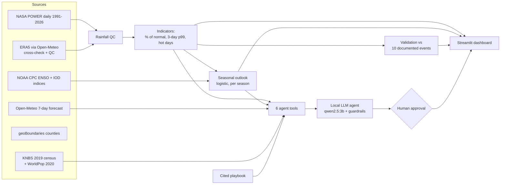

# Ukame Watch

**Drought, heavy-rain and heat early-warning support for eight arid counties of northern Kenya.**
*Ukame* is Swahili for drought.

Zetech Alumni × Student Hackathon 2026 · ML & Data Science track · **Challenge 1: Climate Sentinel**

**Submission report (every deliverable, linked): [SUBMISSION.md](SUBMISSION.md)**

**Live demo: https://patrickwangai.github.io/ukame-watch/** — runs entirely in your browser (first load about 1–2 minutes while Python downloads). The advisory assistant needs a local model, so it runs only when you install the project (see Quick start).

> **Planning-support tool only — not an official warning system.** Kenya Meteorological Department warnings
> and NDMA drought bulletins always take priority. Advisories are drafts until a named person approves them.

## Who it is for and what it answers

A **county disaster manager** in Turkana, Marsabit, Wajir, Mandera, Garissa, Isiolo, Samburu or Kitui
(5.6 million people, KNBS 2019 census) needs four answers in plain language:

| Question | Where Ukame Watch answers it |
|---|---|
| Is this season unusual? | Situation board and map: 3-month rainfall as % of the 1991–2020 normal, drought level |
| What is likely next? | Seasonal outlook (next 3 months) and live 7-day heavy-rain / heat watch |
| Who is exposed? | Population per county and by drought class; hot-day trends |
| What should we prepare? | Cited action playbook, and an assistant that drafts advisories for human approval |

Secondary users who act on the same information: county agriculture and livestock officers, and humanitarian
partners planning water, cash and nutrition support.

## SDG impact statement

| SDG | Target | How Ukame Watch contributes |
|---|---|---|
| **13 Climate Action** (primary) | 13.1 Strengthen resilience and adaptive capacity to climate-related hazards | Turns 35 years of climate data into county-level drought, heavy-rain and heat signals with tested skill, so preparedness starts before a season fails |
| **2 Zero Hunger** | 2.4 Sustainable food production and resilience to drought and floods | Early drought signals give livestock and agriculture officers time for water repairs, pasture planning and timely offtake |
| **1 No Poverty** | 1.5 Reduce exposure of the poor to climate-related extreme events | The eight counties are among Kenya's poorest; earlier water, cash and nutrition support protects household assets |
| **11 Sustainable Cities and Communities** | 11.5 Reduce deaths and people affected by disasters | Heavy-rain watches prompt early warning and evacuation preparation in flood-prone areas |

**What we can and cannot claim.** Ukame Watch shortens the time between a rainfall signal and a county
conversation about preparedness. It does not measure hunger, livestock losses or impact, and it does not
replace NDMA or KMD. Its value depends on officers acting on its drafts, and we have not yet tested it with them.

## Results

| What we checked | Result |
|---|---|
| Documented disasters detected by our indicators | **10 of 10** (5 droughts, 5 heavy-rain/flood periods) |
| Worst 3 droughts and worst 3 heavy-rain periods in our data | **all 6 match documented events** (3 added after being flagged, then verified independently; labelled) |
| Seasonal outlook, Oct–Dec short rains, test 2017+ | Brier skill score **+0.12** vs climatology; F1 **0.61** vs 0.46 for persistence |
| Seasonal outlook, Mar–May long rains, test 2017+ | Brier skill score **−0.05**: **no skill**, and we say so |
| Hot-day trend (max temperature above county 95th percentile) | **+5 to +10 days per decade**, significant in 7 of 8 counties (p < 0.05) |
| Rainfall data errors found and fixed | **11 days** (up to 608 mm/day) replaced after an ERA5 check; 1 genuine flood day kept |
| Assistant evaluation (8 questions incl. cyclone path, fake county, "say no risk") | All grounded or correctly refused; questions using tools take **12–48 s** on a MacBook Air M1 (8 GB) with the dashboard also running; code-level refusals are instant |

Details: `notebooks/01_weather_behaviour.ipynb`, `notebooks/02_forecasting.ipynb`, `logs/agent_eval.md`.

## Quick start

```bash
python3.12 -m venv .venv && source .venv/bin/activate
pip install -r requirements.txt

python tools/build_all.py              # one command: fetch data, QC, indicators, validation, outlook (~20 s)
streamlit run app/streamlit_app.py     # dashboard at http://localhost:8501

# Assistant (optional, runs locally — nothing leaves the laptop)
ollama pull qwen2.5:3b
python tools/run_agent_eval.py                    # 8-question evaluation -> logs/agent_eval.md
python tools/run_agent_eval.py --review "Name"    # same, with a person approving or rejecting each draft

pytest                                  # 86 tests
```

Processed results are committed in `data/processed/`, so the dashboard runs even without internet
(the live 7-day watch then says it is unavailable).

The live demo is `index.html` (generated by `python tools/make_web_demo.py`): the same dashboard running in the browser with [stlite](https://github.com/whitphx/stlite), served by GitHub Pages from this repository.

## How it works



- **Indicators** (`src/ukame/analysis.py`): monthly normals (1991–2020), Mann-Kendall trends with Sen's slope,
  longest dry spell, heavy-rain days (> wet-day p95), max 3-day rain; **drought** = 3-month rainfall as % of
  normal; **heavy rain** = 3-day total above the county's 99th percentile; **heat** = max temperature above the
  county's 95th percentile. All thresholds come from the normal period only.
- **Seasonal outlook** (`src/ukame/outlook.py`): will the next 3 months fall in the driest third? Separate
  logistic models per season group using ENSO, the Indian Ocean Dipole and recent rainfall. Time-based split
  (train ≤ 2016, test ≥ 2017), training-only thresholds, compared with climatology and persistence.
- **Agent** (`src/ukame/agent.py`, `agent_tools.py`, `guardrails.py`): six tools (current status, 7-day watch,
  outlook, heat stress, population exposure, playbook). The model never calculates. Code refuses cyclone-track
  requests and uncovered counties, blocks "no risk" claims, checks every number against tool outputs, adds cited
  playbook actions when a level is active, logs every tool call, and holds every advisory as a draft until a named
  person approves it.

## Technology stack

| Layer | Technology |
|---|---|
| Language | Python 3.12 |
| Data | NASA POWER daily API (MERRA-2), Open-Meteo (ERA5 cross-check, 7-day forecast), NOAA CPC ENSO and IOD indices, geoBoundaries, KNBS 2019 census, WorldPop |
| Analysis | pandas, NumPy, SciPy, pymannkendall (trend tests), GeoPandas, Shapely, rasterio, rasterstats |
| Model | scikit-learn logistic regression per season, time-based split, Brier skill score vs climatology and persistence |
| AI assistant | Qwen 2.5 3B via Ollama (local), six Python tools, code-level guardrails, JSONL audit logs |
| Dashboard | Streamlit, Plotly |
| Live demo | stlite (Streamlit on Pyodide/WebAssembly), GitHub Pages |
| Notebooks | Jupyter (nbformat, nbconvert), Matplotlib |
| Testing | pytest (86 tests) |
| Hardware | Runs on a MacBook Air M1 with 8 GB RAM; no GPU, no paid services |

## Responsible AI

- No personal data anywhere; all sources are public and aggregated (see `DATA.md`).
- Local model: nothing is sent to a hosted AI service.
- Every number in an advisory is traceable: `logs/tool_calls.jsonl` (every call), `logs/answers.jsonl`
  (every answer and its checks), `logs/advisories.jsonl` (every human decision).
- Honest results: the long-rains outlook has no skill; the indicator flags seasons that were not declared
  disasters; data errors are logged, not hidden. Read `docs/limitations.md`.

## Repository

```
app/streamlit_app.py      dashboard
src/ukame/                pipeline, model, agent and guardrails (tested)
tools/                    build_all.py (one command), fetch_data.py, run_agent_eval.py
data/reference/           documented events, cited playbook, census figures (hand-curated, cited)
data/processed/           build outputs read by the app (regenerated by build_all.py)
notebooks/                weather behaviour and forecasting notebooks (executed)
docs/                     playbook.md (generated), limitations.md
logs/                     agent evaluation and audit logs
tests/                    86 tests
```

## AI assistance disclosure

As the hackathon rules require: this project was built with help from an AI coding assistant (Claude Code,
Anthropic), used for code generation, data-source research and documentation drafting. The team reviewed and
can explain every module. The runtime assistant uses **Qwen 2.5 3B** (Alibaba Cloud, Apache 2.0 licence) via
**Ollama**, locally. All data sources and licences are in `DATA.md`.

## Team

| Member | Role | Owns (can explain and rerun) |
|---|---|---|
| _name_ | Data and QC | Data pipeline, QC and `DATA.md` (`data.py`, `analysis.py`) |
| _name_ | Modelling | Seasonal outlook and validation (`outlook.py`, `validation.py`, notebook 02) |
| _name_ | AI assistant | Agent, guardrails and evaluation (`agent*.py`, `guardrails.py`, `logs/`) |
| _name_ | Product and demo | Dashboard, playbook, live demo and pitch (`app/`, `docs/`) |
